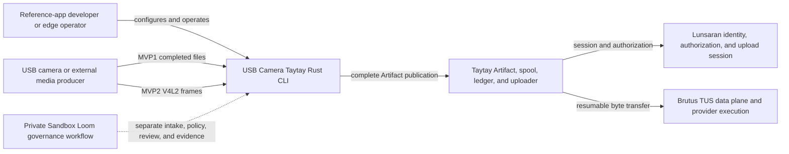
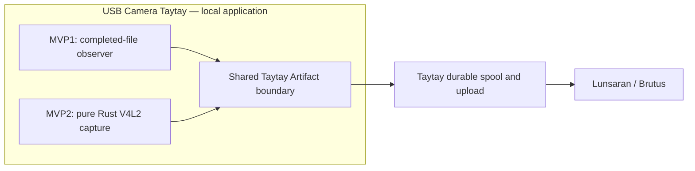

# Context and Scope

## Business context

The reference app receives media locally and hands it to Taytay for durable upload. The architecture has two staged source paths: MVP1 file input and MVP2 camera capture.

Sandbox Loom is shown as a separate project workflow. It does not run in the media path and is not a runtime dependency of USB Camera Taytay.

## Technical context

| Boundary | Responsibility |
| --- | --- |
| USB Camera Taytay | Local configuration, filesystem observation or V4L2 capture, and reference-app orchestration. |
| Taytay | Artifact publication, checksums, durable spool and ledger, retries, resume, cancellation, bounded workers, and upload integration. |
| Lunsaran | Identity, organization/project authorization, and upload-session policy. |
| Brutus | TUS data transfer and provider execution. |
| Sandbox Loom | Separate governed intake, policy, harness, quality evidence, review, and approval workflow. |

The application integrates with the published Taytay and Entregar crates. It does not build or change Lunsaran or Brutus as part of this project.

## Scope boundary

The two MVP source paths converge before publication. Replacing the producer in MVP2 must not create a second upload implementation. The app does not include a hosted camera service, direct object-storage upload, or video analytics.
