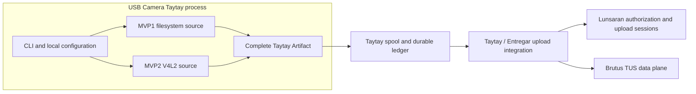

# Building Block View

This is a **logical view derived from the approved scope**, not a claim about the current Rust module layout. Internal module boundaries remain implementation detail unless documented in the code or an accepted decision.

## Responsibilities and boundaries

| Building block | Responsibility | Ownership |
| --- | --- | --- |
| CLI and local configuration | Consumer-oriented commands, source selection, and local operation. Command names and configuration are documented before being treated as stable. | USB Camera Taytay |
| MVP1 filesystem source | Observe the configured input directory and emit only complete, readable files with stable identity and available metadata. | USB Camera Taytay |
| MVP2 V4L2 source | Inspect and open one configured device, negotiate the selected mode, manage buffers, and write bounded complete segments. | USB Camera Taytay |
| Taytay Artifact boundary | Common publication contract used by both source paths. | Taytay integration boundary |
| Spool and durable ledger | Durable local artifact and job state, checksums, recovery, and upload scheduling. | Taytay |
| Upload integration | Session creation and artifact transfer through the supported uploader. | Taytay / Entregar |
| Authorization and data plane | Lunsaran owns identity and upload-session policy; Brutus owns TUS transfer and provider execution. | Lunsaran / Brutus |

Sandbox Loom is not an application building block. It governs intake, bounded execution, evidence, review, and approvals in a separate workflow.
