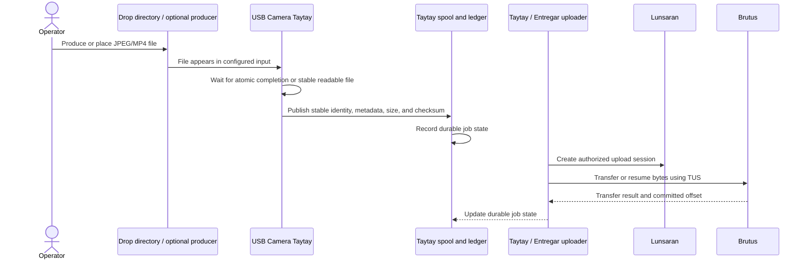

# Runtime View

The scenarios below describe required behavior from the project scope. They do not claim that every path is implemented today.

## MVP1: completed file to upload

The app must not mutate or delete a source before durable publication and successful upload completion. The accepted retention answer keeps successfully uploaded source files in the configured archive until an operator removes them.

## Recovery and repeated execution

On restart or repeated observation, stable artifact identity and Taytay's durable ledger prevent a second logical job. Temporary transfer failures remain inspectable and retryable; bounded retries and resume use Taytay's behavior and the remote TUS offset. Authorization and protocol failures are classified rather than hidden as transport retries. Diagnostics omit credentials, signed URLs, and media.

## MVP2: camera capture to the same upload path

The pure Rust capture loop opens one configured V4L2 device, inspects or uses its selected supported mode, safely returns streaming buffers, and writes bounded timestamped segments. It publishes only complete readable artifacts through the same Taytay Artifact boundary as MVP1. When spool capacity or upload throughput constrains capture, backpressure is applied at that boundary. Malformed frames, shutdown, disconnect, and reconnect must not corrupt completed artifacts. The exact camera mode is recorded after hardware inspection.
