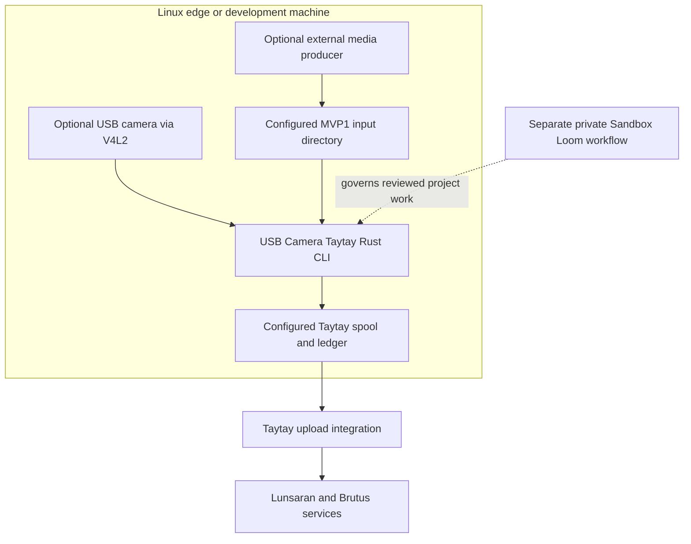

# Deployment View

## Local reference setup

The deployment target is a local Linux application, not a hosted control plane. MVP1 setup and camera-independent acceptance use synthetic files and do not require production credentials, a camera, or live Lunsaran. MVP2 hardware work uses one configured V4L2 device. Local Lunsaran/Brutus services are used for end-to-end acceptance when provisioned.

## Operational boundaries

- Run the app unprivileged and grant only the filesystem, device, and network access explicitly needed for the selected run.
- Keep the spool narrowly scoped and bound its use, memory, segment size, and capture pressure.
- Store credentials in protected local files. Do not include them, signed URLs, or captured media in committed evidence.
- Hardware acceptance records Linux version, camera model, negotiated mode, segment settings, checksum, and disconnect/reconnect result. It supplements deterministic tests; it does not replace them.
- No production hosting topology, availability target, or fleet deployment is specified.
