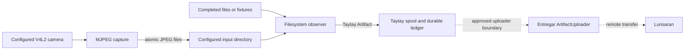

# Architecture summary

## Objective

Provide a small, reproducible Linux Rust CLI reference application that captures or receives local USB-camera media and delivers durable, checksum-bound, resumable uploads to Lunsaran through Taytay, while keeping filesystem ingestion and pure Rust V4L2 capture as deliberately staged MVPs.

## Constraints

```yaml
---
application: One Linux reference application; one configured MVP1 input directory;
  one configured MVP2 V4L2 device.
cli: Rust CLI; command names and behavior should be consumer-oriented and documented
  before being treated as stable.
mvp_boundary: MVP1 consumes completed files from an external producer or fixtures;
  MVP2 replaces that producer with a pure Rust V4L2 capture loop.
artifact_contract: Filesystem and V4L2 source boundaries produce the same Taytay Artifact
  contract; only complete, stable, readable artifacts are emitted.
durability: Publication is atomic and checksum-bound before upload; the durable ledger
  is authoritative for local job state; the remote TUS offset is authoritative for
  resumable transfer.
retry: Retries are bounded and classified; permanent authorization or protocol failures
  are not hidden as transport retries.
upload_boundary: Use published lunsaran-taytay and lunsaran-entregar integrations
  and Taytay ArtifactUploader; no application-specific HTTP or TUS upload path.
local_tests: Synthetic fixtures and camera-independent tests are required; camera
  hardware is not required for ordinary unit and mock acceptance.
hardware: MVP2 targets one configured /dev/video* device and initially supports one
  verified pixel format, resolution, and frame interval.
operations: Keep the application unprivileged and use a narrowly scoped writable spool;
  bound memory, segment size, spool, and capture-to-upload pressure.
deployment: Local reference application and integration example; no hosted control
  plane or production deployment scope is defined.
```

## Components



The solid paths are the local workflows implemented by this CLI. The dotted
path is the approved architecture boundary for remote transfer; the current
commands do not start it. No application-specific HTTP or TUS upload path is
implemented. Brutus is part of the provisioned platform context for optional
live acceptance, not a local service required by fixture or mock checks.

## Source and publication lifecycle

MVP1 observes completed JPEG and MP4 files in one configured input directory.
It requires stable observations, derives artifact IDs from content, publishes
through Taytay's spool and ledger, and verifies the checksum. Duplicate content
is skipped when the full checksum matches the ledger; a checksum conflict for
an existing ID is an error. A later run archives the source and optional
sidecar only when the ledger reports `Completed` or `Retained`.

MVP2 opens one configured V4L2 device and negotiates the configured mode. It
maps four buffers, copies dequeued frame bytes, and returns each buffer to the
driver. The current writer accepts MJPEG only, validates JPEG completeness,
and writes timestamped JPEGs with capture-time JSON sidecars using synced
`.part` files and atomic rename. Frame count and total bytes are bounded per
invocation. Before admitting a frame it checks spool usage and pending JPEGs
in the input directory. The completed JPEGs are published only by a subsequent
`run-filesystem` invocation. Shutdown and frame errors release streaming state
and mappings.

## Operational invariants

- Run as an unprivileged user with write access only to the configured input,
  spool, and archive locations and device access required for V4L2.
- Bound individual input size, durable spool quota, capture segment frame
  count, segment bytes, and capture-to-spool pressure.
- Treat the Taytay ledger as authoritative for local lifecycle state. Pause
  and resume persist there; the current CLI does not perform remote transfer.
- Keep credentials, signed URLs, filesystem paths from diagnostics, and media
  payloads out of logs and acceptance evidence.
- Use deterministic fixtures and camera-independent tests for ordinary local
  verification. Physical capture and reconnect claims require recorded hardware
  evidence.

## Delivery stages

The executable plan separates filesystem ingestion, V4L2 capture, operational
acceptance, and consumer documentation into reviewable slices. MVP1's file
ingestion and MVP2's local MJPEG capture path are implemented. The recorded
hardware attempt could not open `/dev/video0` because the operator lacked
`video` group access; a successful capture and end-to-end upload are therefore
not claimed. See the [User Guide](../consumer/index.md) for current commands
and the [Integration Guide](index.md) for the artifact boundary.
