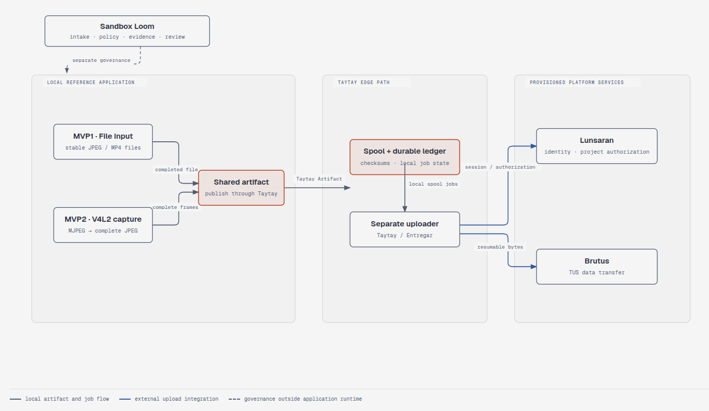

# USB Camera Taytay

USB Camera Taytay is a Linux Rust CLI reference application for moving local
camera media into Taytay's durable artifact spool. It demonstrates two staged
input paths: MVP1 ingests completed JPEG and MP4 files, while MVP2 captures
MJPEG frames from a configured V4L2 camera and sends the resulting JPEG files
through the same ingestion path.

The CLI publishes artifacts to Taytay; a separate, provisioned Taytay uploader
handles transfer to Lunsaran. This application does not start that uploader or
implement its own HTTP or TUS upload path. Fixture and mock checks can be run
locally without a camera or live Lunsaran credentials.

This repository is also a public reference application for the private Sandbox
Loom project. Its documentation shows the project scope, architecture, and
delivery workflow. See the [Sandbox Loom documentation site](https://sandbox-loom-documentation.dogfooding.shop/)
for product documentation. This site does not publish credentials, captured
media, or raw private evidence.

For the repository overview and development quick start, see the
[root README](https://github.com/kanutocd/usb-camera-taytay#readme).

## Architecture overview

MVP1 file ingestion and MVP2 V4L2 capture converge on the same Taytay Artifact
path. A separately provisioned Taytay uploader handles remote delivery;
Sandbox Loom governs project work outside the application's runtime.

{ width="900" }
/// caption
Both input paths publish through Taytay. The CLI does not start the uploader or connect directly to Lunsaran or Brutus.
///

## Choose a guide

- [User Guide](audiences/consumer/index.md) — configure the CLI, ingest files,
  capture from V4L2, and inspect local artifact status.
- [Reference App Guide](audiences/technical/index.md) — understand the source
  adapters, Taytay integration boundary, and acceptance approach.
- [Project Team](audiences/stakeholder/index.md) — read the scope statement,
  project brief, Arc42 architecture, implementation roadmap, and Sandbox Loom
  guide.
